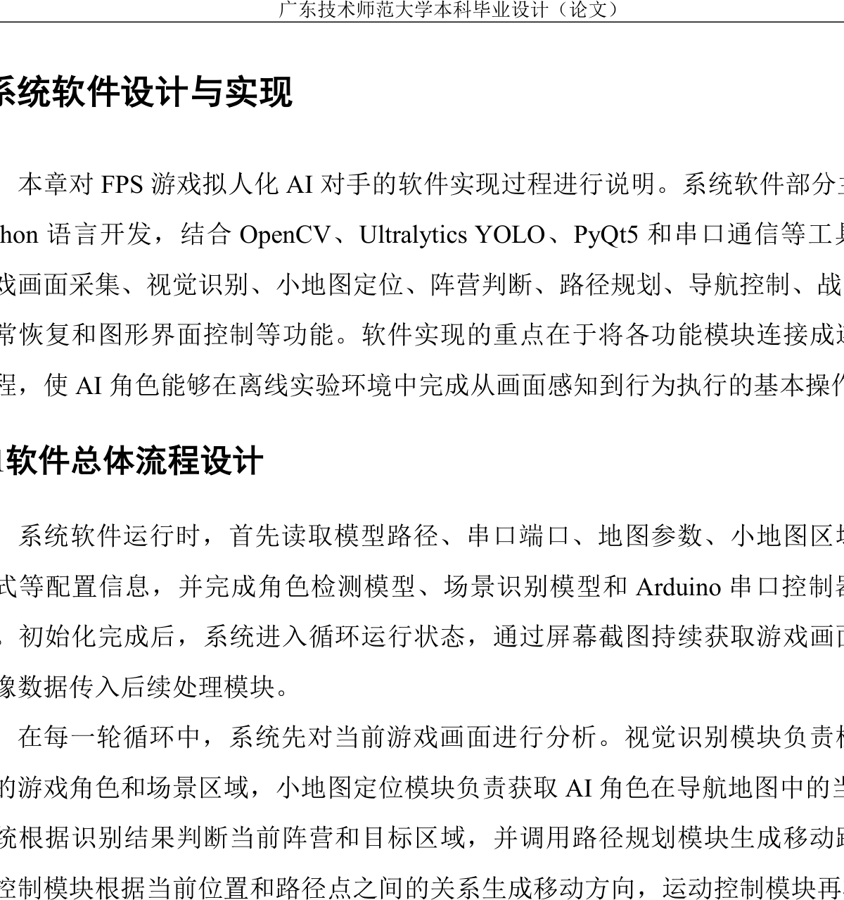
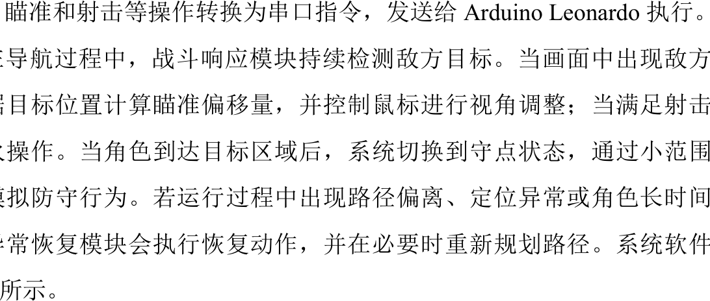
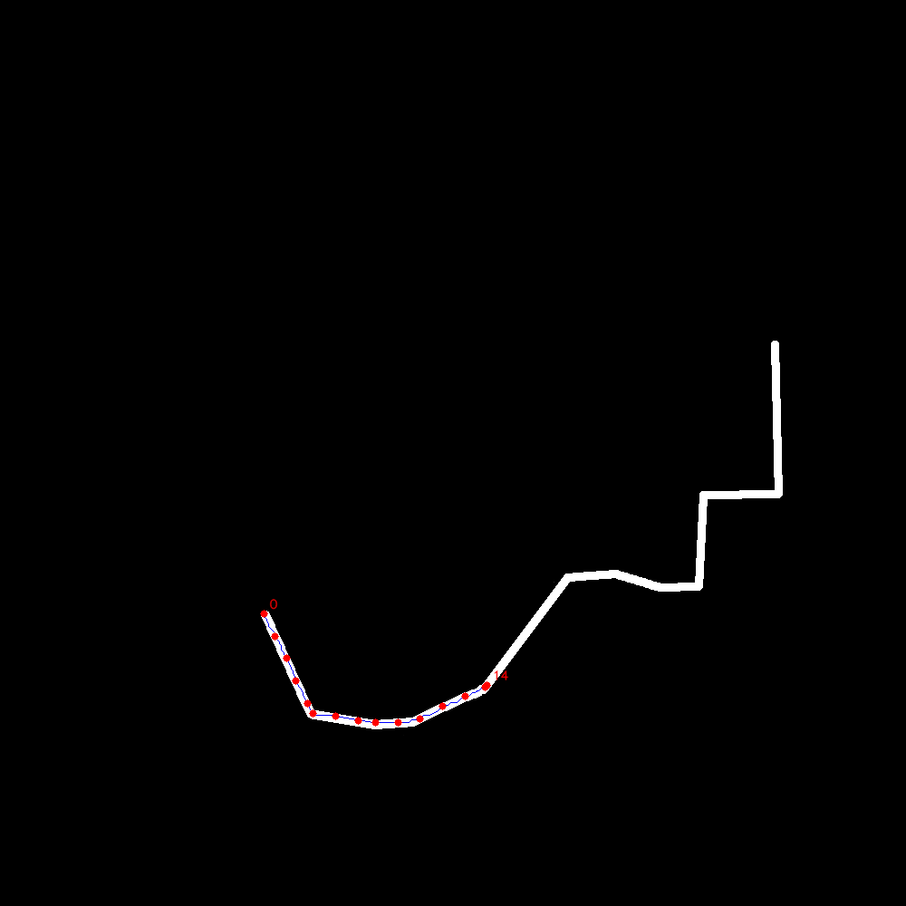
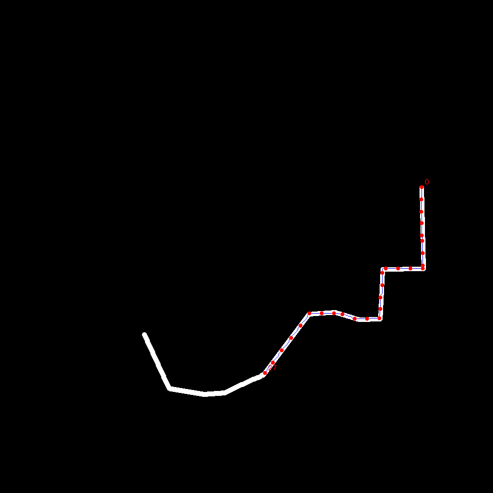
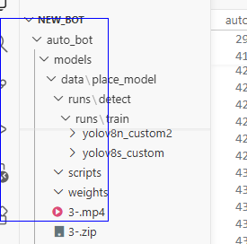
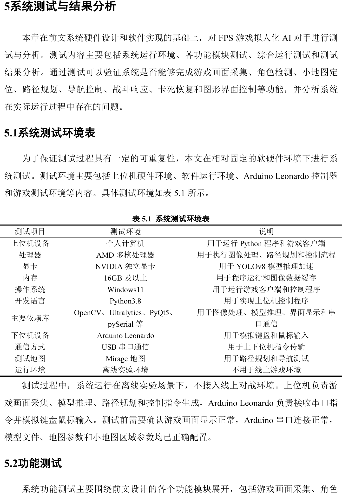
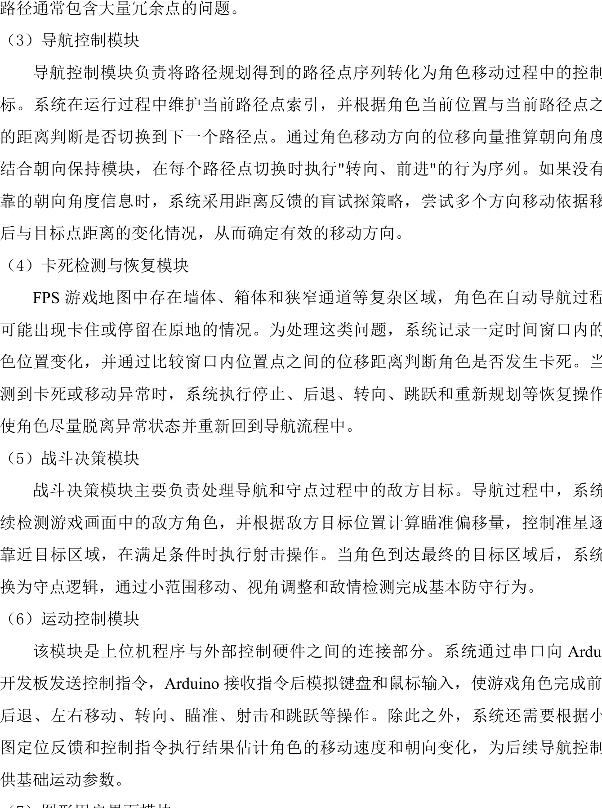
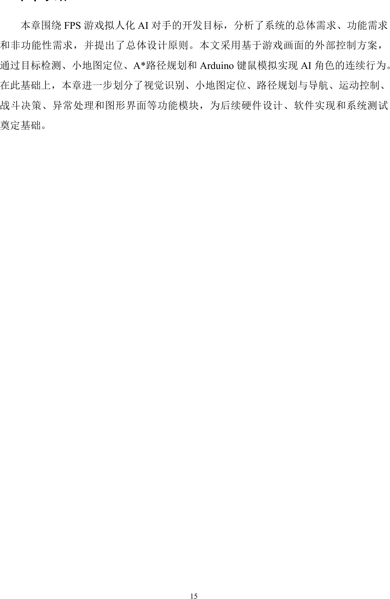
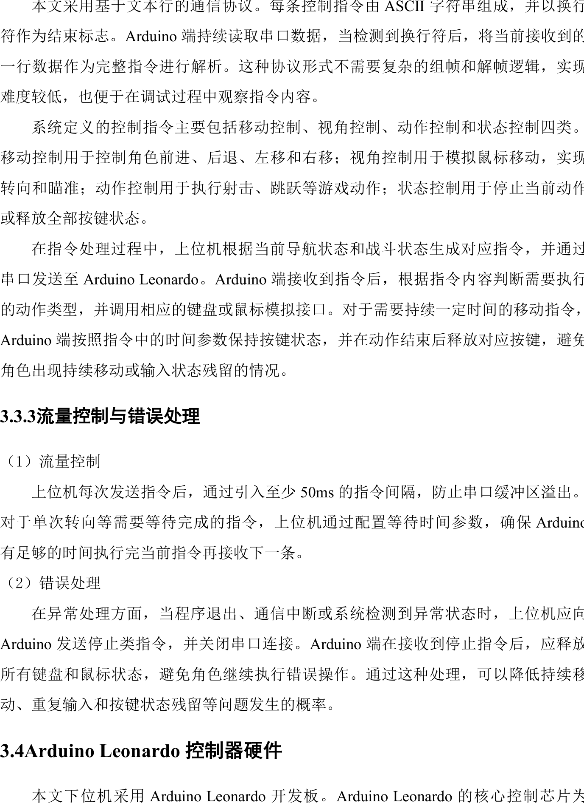

<div align="center">

# AutoBot · CS2 拟人化 AI 陪练机器人

**像人一样"看屏幕、动键鼠"的游戏 AI —— 纯视觉感知 · A\* 自主决策 · 硬件级执行**

Python 3.10+ | Windows | YOLOv8 | A\* | Arduino HID | PyQt5

[演示视频](#-演示视频) · [系统架构](#-系统架构) · [快速开始](#-快速开始) · [产品故事](#-从-mvp-到商业化一个产品完整周期) · [MRD 文档](docs/MRD_AutoBot.md)

</div>

---

> ⚠️ **合规声明**：本项目属于游戏自动化研究工具，可能违反游戏用户协议。仅限**计算机视觉、路径规划等技术学习**与**私有训练环境**使用，禁止用于官方匹配/竞技环境，使用风险自负。详见[文末免责声明](#合规与免责声明)。

## 它能做什么

AutoBot 不依赖任何游戏 API 或引擎修改，而是以"外部观察者"的方式运行：

- **看**：实时截屏 → YOLO 双模型识别人物阵营与场景地标 → HSV 颜色检测在小地图雷达上定位自身位置
- **想**：A\* 算法在二值化地图上实时寻路，规划出生点 → A 点的行进路线
- **动**：串口指令 → Arduino Leonardo 以 **USB HID 硬件身份**模拟真实键鼠操作游戏

一条完整的"感知 → 决策 → 执行"闭环，全部跑通：

| 能力 | 说明 |
|---|---|
| 视觉定位 | 小地图 HSV 定位玩家位置，含位置稳定滤波与朝向估计，ORB 特征匹配兜底 |
| 阵营/场景识别 | YOLO 双模型（人物 ct/t + 场景地标 10 类），三级兜底策略 |
| 自主导航 | 二值化地图 A\* 实时寻路 + waypoint 跟随 + 离墙代价优化 |
| 自主战斗 | 敌人检测 → 瞄准 → 开火，队友挡线防误伤、开火冷却 |
| 守点行为 | 到达目标点后巡逻 + 扫视 + 遇敌开火 |
| 工程韧性 | 卡死检测与恢复、启动运动学自校准、位置跳变过滤 |
| 控制台 | PyQt5 深色 GUI + Dry-run 调试模式 + 6 个标定工具 |

## 🎬 演示视频


*真实游戏环境运行录屏：自主导航至 A 点、遭遇敌人自动开火。*

## 📸 运行效果

<p>


</p>
<p>



</p>

**GUI 控制台**（`python -m gui.main_window`）：



## 🏗 系统架构



三层架构，每层可独立替换：

| 层 | 模块 | 说明 |
|---|---|---|
| **感知层** | `player_locator` / `role_detector` / `place_detector` / `minimap_matcher` | 截屏 → 自身位置 → 阵营 → 场景理解 |
| **决策层** | `navigator` / `auto_navigation` / `anti_stuck` | A\* 寻路、waypoint 跟随、卡死恢复 |
| **执行层** | `arduino_control` → Arduino 固件 | 串口协议 → USB HID 键鼠模拟 |

### 主循环工作流



### 战斗决策流程



### 值得一提的工程细节

这些是真实环境反复踩坑后沉淀的 know-how：

- **三级阵营识别兜底链**：场景地标识别 → 出生点距离推断 → 人物检测，多帧确认后锁定
- **黑区真实恢复**：定位落进障碍区时不做坐标吸附，而是强制走回最近可通行区再重新规划
- **队友挡线检测**：几何线段-包围盒相交判定，防止训练赛中误伤队友
- **运动学自校准**：启动时短脉冲探测测量移动速度与朝向，适应任意鼠标灵敏度设置
- **双定位链路**：HSV 颜色定位为主，ORB 特征匹配为备份，游戏更新时保底可用

## 🚀 快速开始

```bash
# 1. 安装依赖（建议 Python 3.10+ 虚拟环境）
pip install -r requirements.txt

# 2. Dry-run 模式：不接硬件，只做视觉识别与决策日志
python main.py --verbose

# 3. 正式运行（需 Arduino Leonardo，固件见 arduino/）
python main.py --arduino --verbose --enable-recovery

# 4. 图形界面（可选）
python -m gui.main_window
```

模型权重已随仓库提供（`models/person.pt`、`models/place.pt`），克隆即可跑 Dry-run。详细的环境准备、硬件接线、标定流程见 **[docs/getting_started.md](docs/getting_started.md)**。

<details>
<summary>目录结构</summary>

```
├── main.py                  # 主入口：主循环与模块装配（约 1200 行）
├── core/                    # 8 个核心模块（感知/导航/战斗/硬件控制）
├── gui/main_window.py       # PyQt5 控制台
├── arduino/                 # Arduino Leonardo 固件（USB HID 键鼠模拟）
├── configs/minimap.json     # 小地图 ROI 与标定映射
├── maps/                    # Mirage 二值导航图 + 路线节点
├── paths/                   # 预生成参考路径
├── models/                  # 自训练 YOLOv8 权重（person.pt / place.pt）
├── tools/                   # 6 个标定与调试工具
├── assets/                  # 演示视频与效果截图
└── docs/                    # 快速入门 / MRD
```

</details>

## 从 MVP 到商业化：一个产品完整周期

这个项目对我而言不只是一段代码，而是一次完整的产品实践：

1. **需求发现**：与电竞俱乐部教练/负责人直接沟通，确认"真人陪练贵、难约、不可重复"的付费动机
2. **MVP 构建**：以"外部视觉 + 硬件输入"路线避开游戏 API 依赖，交付全链路闭环（即本仓库代码）
3. **付费验证**：在客户私有训练服环境落地，服务数十名付费用户，跑通早期商业化闭环
4. **产品化沉淀**：将验证结论体系化为完整 MRD（市场规模、竞争分析、P0-P2 需求分级、商业模式、路线图）

> 📄 **[查看完整 MRD（市场需求文档）→](docs/MRD_AutoBot.md)** —— 包含市场分析、用户画像、竞争格局、产品需求分级与商业化路线图。

## 🗺 路线图

| 阶段 | 方向 |
|---|---|
| P0 | 全竞技地图支持 · 可配置难度系统 · 一键部署 · 多 Bot 协同 |
| P1 | 战术脚本引擎 · 训练数据与复盘 · 基于 VLM/强化学习的拟真行为升级 |
| P2 | 云端训练平台 · 感知-决策-执行中台能力复制到其他 FPS 品类 |

## 合规与免责声明

- 本项目仅供**计算机视觉、目标检测、路径规划、嵌入式硬件控制**等技术学习与研究使用
- 仅限**私有训练环境**运行，**严禁**用于官方匹配、竞技比赛或任何影响他人正常游戏体验的场景
- 使用本项目可能违反游戏服务条款并导致账号封禁，风险由使用者自行承担
- 项目不对任何基于本代码的衍生使用行为承担责任

## License

版权所有，保留所有权利。本仓库内容仅授权用于个人学习与技术交流，**禁止商业使用**。引用或借鉴请署名并附上本仓库链接。

## 致谢

- 地图 A\* 可视化参考了 [Visual-Astar-Pathfinding-Tool](https://github.com/kongkong985/Visual-Astar-Pathfinding-Tool) 的思路
- YOLO 训练基于 [ultralytics](https://github.com/ultralytics/ultralytics) 生态

---

<div align="center">

**如果这个项目对你有启发，欢迎 Star ⭐ 支持**

</div>
